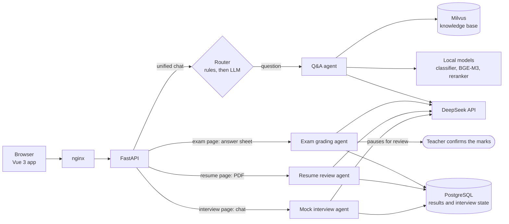

# EduAgent

AI teaching assistant for tech learners, built as a set of LLM agents with an offline
evaluation for each one. A student can ask questions about course material, submit an exam
that is graded and checked by a teacher, get a resume review, and practise a mock interview,
all from one chat that routes each message to the right agent.

The goal of the project is to show how to build agents that can be measured: every agent has
a labeled dataset and target metrics, and one command reruns them all and reports quality,
latency and cost.

## What it does

| Agent | What it does | How |
|---|---|---|
| **Q&A** | Answers questions from a knowledge base of 12 public documentation pages (FastAPI, TypeScript, React, LangGraph, ...); answers directly when the question is off-topic | Fine-tuned MiniLM classifier, HyDE / multi-query rewriting, hybrid BGE-M3 search in Milvus, BGE reranker, optional web search |
| **Exam grading** | Grades a Word answer sheet against scoring points, then pauses for a teacher to confirm or change each mark | LangGraph with a human-in-the-loop interrupt |
| **Resume review** | Scores a PDF resume on six dimensions and lists prioritized issues with fixes; instructed never to guess or comment on protected traits (checked by the eval) | Parallel per-dimension LLM calls with fallbacks |
| **Mock interview** | Runs a five-stage interview based on the target role and the reviewed resume, then writes a report | Stateful LangGraph, state kept in Postgres so sessions survive a restart |
| **Unified chat** | Routes each message to one of the agents above | Rules first, LLM routing when the rules are unsure |

Stack: FastAPI, LangGraph, PostgreSQL, Milvus, Vue 3 + Element Plus, DeepSeek
(OpenAI-compatible API), local Hugging Face models for embeddings, reranking and
classification. Everything runs with Docker Compose.



The unified chat answers questions itself and replies to exam, resume and interview requests
with a link to the right page, where the file upload or the interview happens.

## Results

Latest evaluation runs (DeepSeek `deepseek-v4-flash`, thinking disabled). Datasets are small
and hand-labeled, so read these as regression checks rather than benchmarks.

| Area | Metric | Result | Target | Data |
|---|---|---|---|---|
| Routing | accuracy | 1.00 | ≥ 0.90 | 48 messages |
| Q&A | recall@3 after reranking | 0.95 | ≥ 0.80 | 20 in-scope questions |
| Q&A | answer correctness (LLM judge) | 1.00 | ≥ 0.80 | 20 in-scope questions |
| Exam | mean \|AI − teacher\| / full score | 0.052 | ≤ 0.15 | 18 answers |
| Exam | Cohen's κ (low / mid / high bands) | 0.88 | ≥ 0.60 | 18 answers |
| Resume | overall score MAE vs. labels | 8.2 | ≤ 8 | 10 resumes × 2 runs |
| Resume | issue recall | 0.89 | ≥ 0.70 | 10 resumes |
| Interview | report quality (LLM judge, 1–5) | 4.8–5 | ≥ 3 | 5 simulated candidates |
| Interview | reply latency P95 | 3.5 s | ≤ 5 s | 52 turns |

The resume score MAE is just above its target after a fairness rule was added to the prompt;
the eval reports it as a failure on purpose. Off-peak cost is about $0.0003 per Q&A answer
and $0.007 per resume review.

## Quick start

You need Docker, Python 3.11, and a [DeepSeek API key](https://platform.deepseek.com/).
Node 20 is needed only for frontend development.

**1. Configure**

```bash
cp .env.example .env.local
```

Fill in at least `DEEPSEEK_API_KEY`, `JWT_SECRET_KEY` (32+ characters), the database and
MinIO credentials, and the three `SEED_*_PASSWORD` values (12+ characters). `.env.local` is
git-ignored.

**2. Install the Python environment** (used for setup scripts and local development)

```bash
pip install torch==2.5.1 --index-url https://download.pytorch.org/whl/cpu   # CPU build
pip install -r requirements.lock.txt
pip install -e . --no-deps --no-build-isolation
```

**3. Download the local models and train the classifier** (about 3 GB)

```bash
huggingface-cli download BAAI/bge-m3 --local-dir models/embedding/bge-m3
huggingface-cli download BAAI/bge-reranker-v2-m3 --local-dir models/reranker/bge-reranker-v2-m3
huggingface-cli download sentence-transformers/all-MiniLM-L6-v2 --local-dir models/classifier/all-MiniLM-L6-v2
python -m backend.core.query_classifier          # fine-tunes into models/classifier/finetune-en
```

**4. Start the databases and load the data**

```bash
docker compose --env-file .env.local up -d postgres milvus    # schema is created on first start
python scripts/seed_data.py                      # admin, teacher01, student01, student02
python -m scripts.seed_standard_exam             # sample exam
python -m scripts.seed_interview_questions       # interview question bank
python -m scripts.demo.seed_demo                 # optional: sample results for student01 (no LLM calls)

python -m scripts.knowledge.fetch_sources        # download the documentation pages
python scripts/init_milvus.py                    # create the vector collection
python -m scripts.build_knowledge_base           # chunk, embed and index
```

**5. Run the app**

```bash
docker compose --env-file .env.local up -d --build
```

Open http://localhost:8080 and sign in as `student01` or `teacher01` with the password from
`.env.local`. Attu (Milvus admin) is at http://localhost:30000.

With the demo data loaded, `student01` already has a resume review, an exam graded by the AI
and confirmed by `teacher01`, and a finished mock interview with its report, all for a
fictional candidate. The results were recorded once from the real agents
(`scripts/demo/generate_demo_data.py`); rerunning `seed_demo` resets `student01` to them.

### Local development

```bash
uvicorn backend.main:app --port 8010 --reload    # API docs at http://localhost:8010/docs

cd frontend
cp .env.example .env.local                       # streams call the backend directly
npm install
npm run dev                                      # http://localhost:3000
```

## Evaluation

```bash
python -m scripts.evaluation.run_all             # every eval, then a summary table
python -m scripts.evaluation.run_all --only qa exam
```

Each eval writes Markdown and JSON reports to `eval_results/` (git-ignored), and the summary
compares every metric with its target. The evals call the real LLM: a full run takes about
20 minutes and costs roughly $0.20 at off-peak prices. Datasets live in `scripts/evaluation/datasets/`; all
resumes and candidates in them are fictional.

## Tests

```bash
python -m pytest                                 # unit tests; integration tests need Postgres
```

GitHub Actions runs the unit and integration tests against a fresh Postgres, builds the
frontend, and scans the history for secrets and personal data. The tests never call the LLM.

## Project layout

```
backend/
  agents/        qa, exam, resume, interview: LangGraph graphs, nodes, prompts
  api/v1/        REST and streaming (SSE) endpoints
  core/          LLM factory, orchestrator, knowledge base, classifier, rate limits
  mcp/           knowledge base and web search as MCP servers
frontend/        Vue 3 app, served by nginx in Docker
scripts/
  evaluation/    evals, datasets, cost and summary tools
  knowledge/     knowledge base sources (pinned) and downloader
docker-compose.yml
```

## Notes

- Requests are rate-limited per user and per login address; LLM calls time out after 60 s
  and are retried with backoff.
- The knowledge base documents are not stored in this repository; see
  [scripts/knowledge/README.md](scripts/knowledge/README.md) for sources and licenses.
